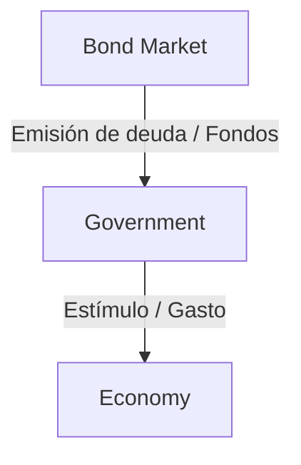
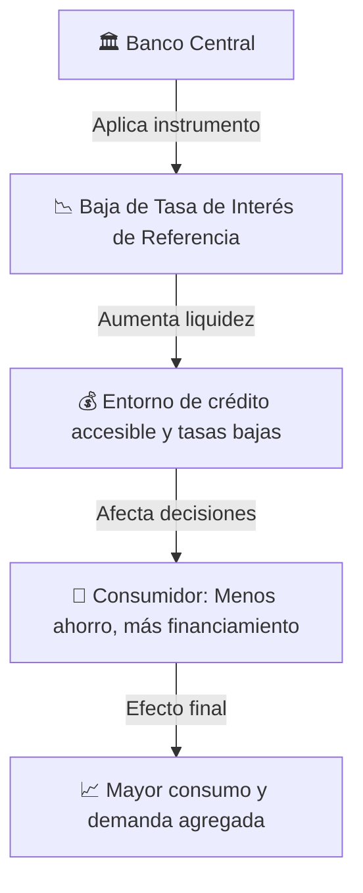
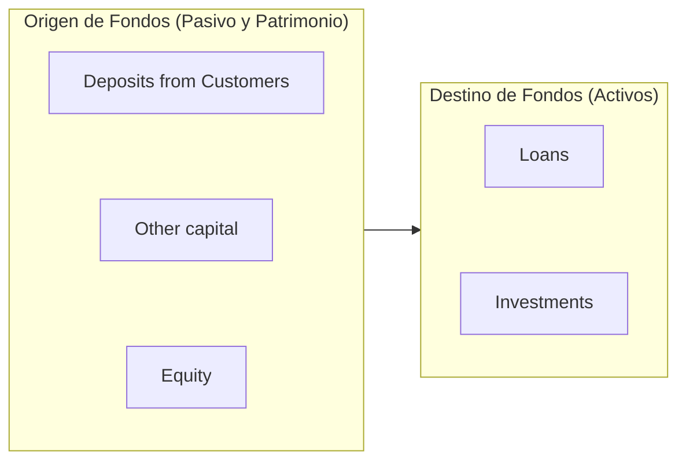
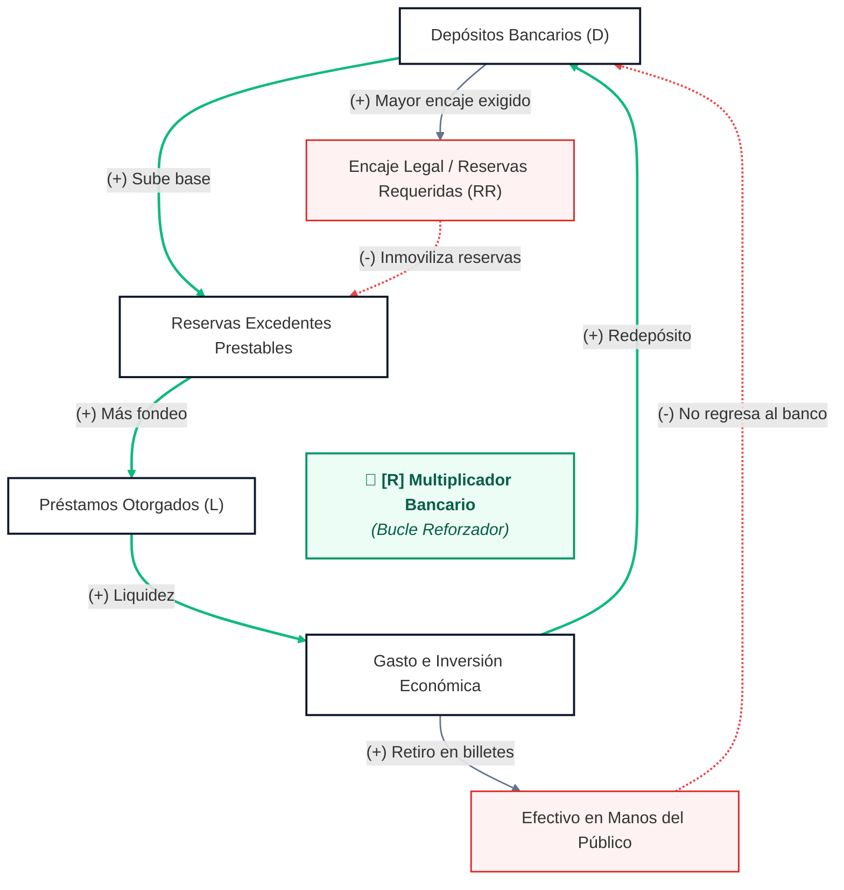

## 2. Economics
Investments <- savings <- Sources: Employment, Profit, Returns 

### COMMON ECONOMIC MEASURES:
Una economía puede expandirse o contraerse(Recesión) y en casos extremos (Depresión)
- GDP: The value of all goods and services in final form purchased by costumers, it can be measured by expenditure or income.
	- Expenditures by category
		- Consumers (C)
		- Investments by Business (I)
		- Government Expenditures (G)
		- Exports - Imports (X-M)
	- Cuando se analiza el GDP, se examina tanto la variación del ==precio== y de la cantidad de los bb.ss consumidos
- GDP deflator
- Potential Output
	- Es el nivel al que la economía debería estar teóricamente.
	- Comparar el teórico con el observado nos da una métrica clave: La **brecha producto (Output Gap)**
- Inflation
	- Implications:
		- Investments -> TVM | Inflation is the enemy of investments
- Employment
	- Se mide a través de NFP

### LEADING INDICATORS:
- CPI : Consumer Price Index | Inflación - Deflación
- PMI : Purchasing Managers Index
- NFP : NonFarm Payroll employment report

### MECÁNICAS:

**↓ Employment**
___
**Agente: Gobierno**
Instrumento: Déficit Financing
Data: Government Déficit

- Efectos: ↑ G -> ↑ GDP
___
**Agente: Central Bank - US Federal Reserve (FED)**
Mandato: Maximizar el empleo, Estabilidad de precios
![[Pasted image 20261011121842.png]]
Instrumento: Monetary Policy, Fed Funds rate (8/año) | Fed Open Market Committee
Money Supply Data: M2 (Currency, bank deposits, Other pools of cash )
- M2 vs CPI
![[Pasted image 20261011121714.png]]

- Tasas de interés
	- Data: Fed funds target rate (FOMC Meets)
	- Target: 2%
	- ↑ rates -> ↓ Borrowing -> Slows Economy | Tightening 
	- ↓ rates -> ↑ Borrowing -> Slows Economy | Easing 

- FED Financial Statements

### Interest Rates (i)
- Is the rental cost of money
**↑ i -> Tightening**
**↓ i -> Easing**

___
Agente: Consumidor
- Efecto: Podrá obtener menos dinero para comprar cosas en la economía

REPO: Repurchasing Agreement
![[Pasted image 20261011171042.png]]

YIELD CURVE
- Es un buen indicador de recesiones o recuperaciones de la economía
![[Pasted image 20261011171623.png]]

- Inverted or Flat -> Slowing economic activity -> Cuando la economía se enfría se espera que la demanda de dinero caiga

### The Rol of Banking Industry
Mecanismo Macro
![[Pasted image 20261011215217.png]]

Mecanismo del negocio del banco

- **Apalancamiento**: Capacidad para incrementar los efectos de los retornos ya sea positivo o negativo.

- Los bancos generan sus ingresos por el diferencial de la tasa activa - tasa pasiva
- El retorno de los activos es usualmente 1% es bastante bajo. A pesar de ser bajo es porque el capital de los shareholders está apalancado; su porcentaje de equity es relativamente bajo en comparación a lo recaudado de los depósitos.

![[Pasted image 20261011222132.png]]

PRINCIPALES RIESGOS:
- Liquidity risk
- Operational risk
- Credit risk
- Market risk

Sistema de Multiplicador del dinero

- Multiplicador del dinero: es el mecanismo cómo se mueve el dinero en la economía 
	- El banco central puede modificar el dinero disponible, con las tasas de encaje y 
	- Para prevenir que el banco quiebre se instauró el uso de Fondo de Seguros de Depósito (FSD) - Se instauró en 1988 en consecuencia de la Crisis Latinoamericana de 1980's
	- Basel 1, 2, 3

### DOCUMENTOS:
- LTEO:  Long Term Economic Outlook 

![[2026-10-07_20h20_51.jpg]]

