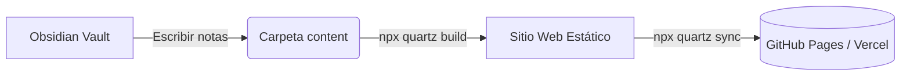

# Bienvenido a tu Jardín Digital con Quartz y Obsidian 🌿

Este espacio está configurado y optimizado para publicar notas en formato **Obsidian Flavored Markdown (OFM)** utilizando [Quartz 5](https://quartz.jzhao.xyz).

---

## 🚀 Características activas de Obsidian

### 1. Enlaces bidireccionales (Wikilinks)
Puedes vincular notas usando sintaxis de Obsidian:
- Enlace a otra nota: [[Primera Nota]]
- Enlace con alias: [[Primera Nota|Ver mi primera nota de prueba]]

### 2. Callouts
> [!TIP]
> Los callouts de Obsidian se visualizan con el diseño nativo de Quartz.

> [!NOTE]
> Puedes abrir directamente la carpeta `content/` de este proyecto como un **Vault en Obsidian**.

### 3. Listas de tareas interactivas
- [x] Clonar repositorio oficial de Quartz
- [x] Instalar dependencias del sistema
- [x] Configurar plantilla `obsidian`
- [x] Habilitar soporte para idioma español (`es-ES`)
- [ ] Escribir mis primeras notas

### 4. Soporte matemático (LaTeX / KaTeX)
Ecuaciones matemáticas fluidas:
$e^{i\pi} + 1 = 0$

O en bloque:
$$f(x) = \int_{-\infty}^\infty \hat{f}(\xi)\,e^{2 \pi i \xi x}\,d\xi$$

### 5. Diagramas Mermaid

---

## 🛠 Comandos útiles

| Comando                                      | Acción                                                         |
| -------------------------------------------- | -------------------------------------------------------------- |
| `npm run serve` o `npx quartz build --serve` | Iniciar servidor local de desarrollo (`http://localhost:8080`) |
| `npm run build` o `npx quartz build`         | Compilar el sitio estático para producción (en `public/`)      |
| `npm run sync` o `npx quartz sync`           | Sincronizar y publicar cambios en GitHub                       |
